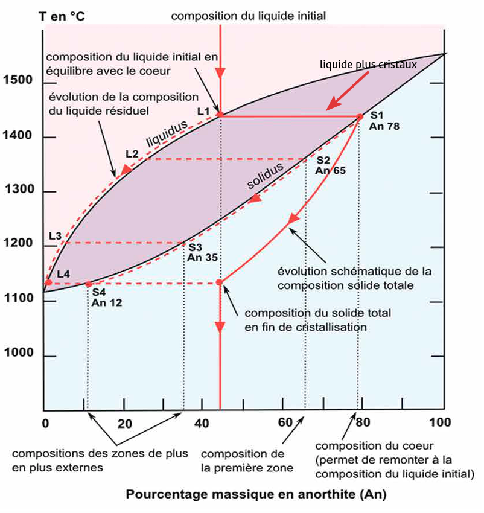
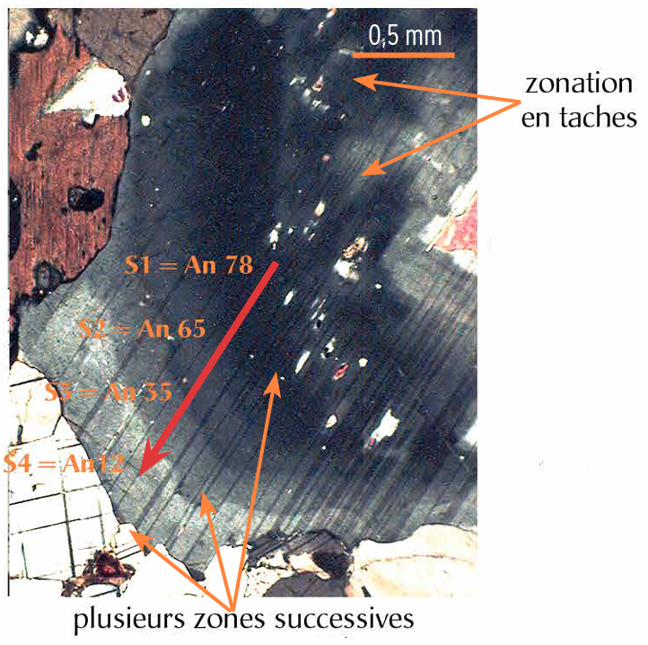
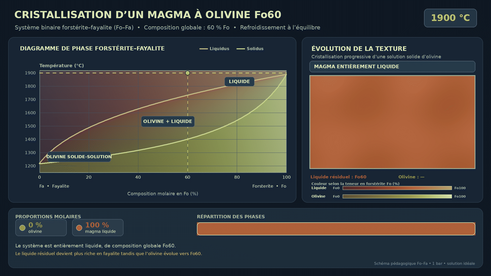
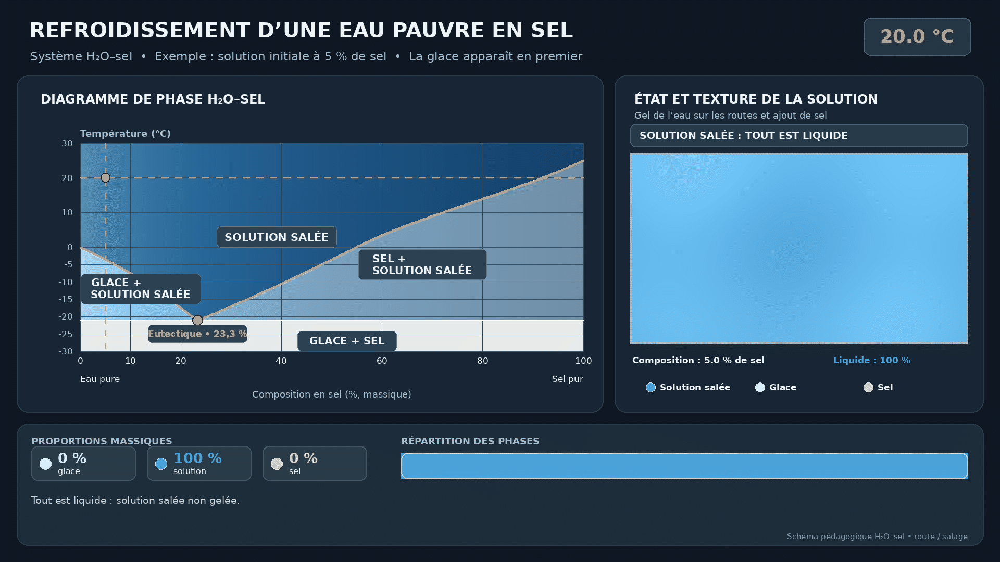
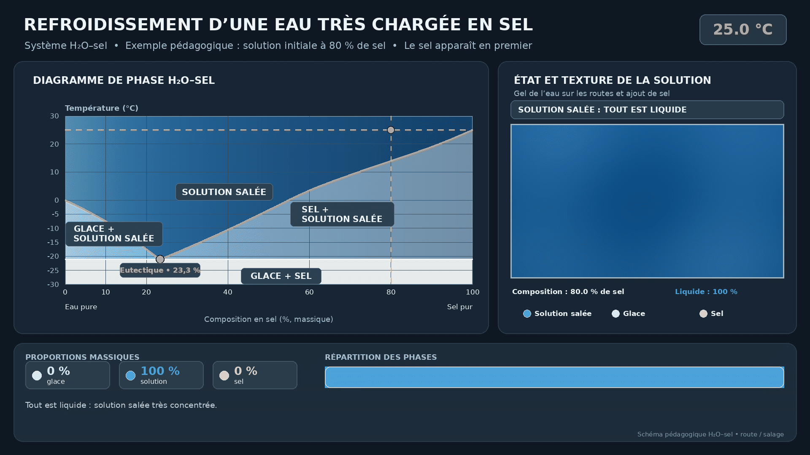
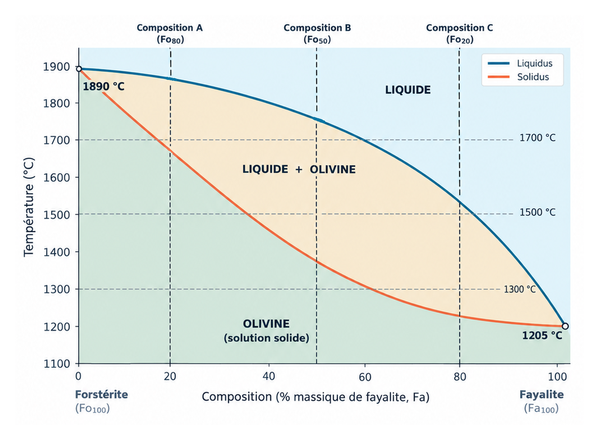
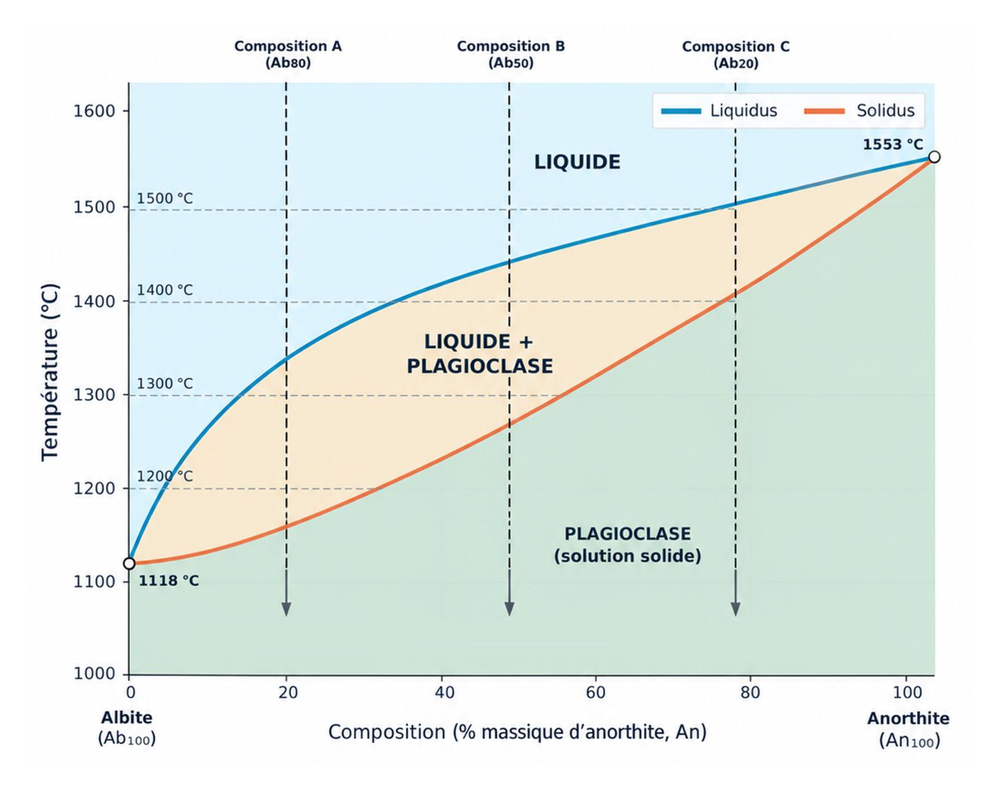
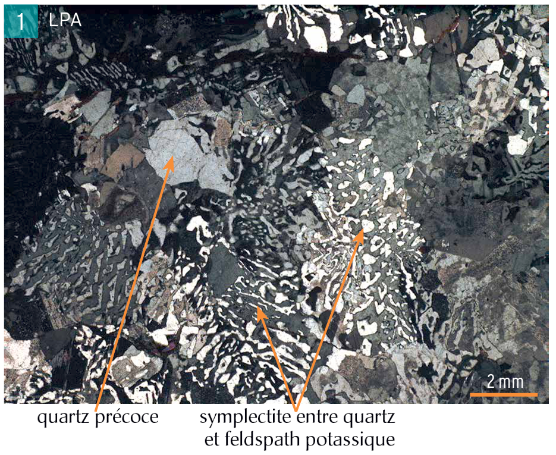
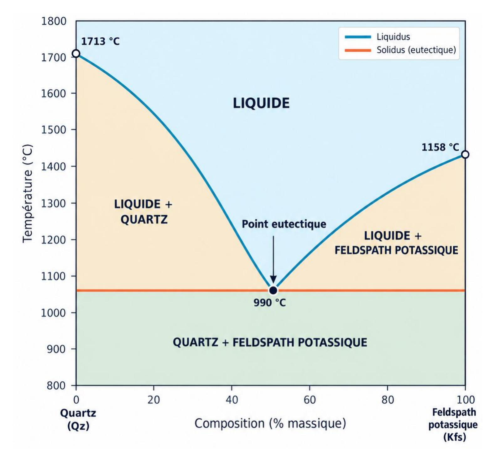

## Principe du TP

Ce TP est conçu pour comprendre l'utilisation de diagrammes de phases appliqués à différents systèmes chimiques simplifiés. Ces diagrammes permettent de visualiser les proportions et les compositions des liquides et des cristaux au cours de la fusion ou de la cristallisation d'un système donné.

À la fin de la séance, vous devriez pouvoir :

- Comprendre l'intérêt des diagrammes de phases et leurs principales limites
- Visualiser les processus de fusion et de cristallisation à l'équilibre
- Déterminer les proportions et les compositions des phases présentes
- Relier la lecture d'un diagramme de phases à certaines textures de roches magmatiques

| Temps | Contenu | Objectif |
|---|---|---|
| 30 min | Introduction | Se familiariser avec le vocabulaire, les méthodes de lecture et les limites des diagrammes de phases |
| 20 min | Exercice 1 : fusion d'une péridotite | Visualiser les proportions et la composition du liquide et des cristaux au cours de la fusion d'une péridotite riche en olivine |
| 20 min | Exercice 2 : cristallisation d'un magma dans la série des plagioclases | Visualiser les proportions et la composition du liquide et des cristaux formés au cours de la cristallisation de la série continue des plagioclases |
| 20 min | Exercice 3 : cristallisation d'un magma dans le système binaire quartz–feldspath potassique | Visualiser les proportions et la composition du liquide et des phases cristallines au cours de la cristallisation du système quartz–feldspath potassique, notamment au voisinage du point eutectique |

## Introduction aux diagrammes de phases

### Définition et utilité

Un diagramme de phases représente les domaines de stabilité des différentes phases d'un système en fonction de variables telles que la température, la pression et la composition. Il permet de déterminer quelles phases sont présentes, ainsi que leur composition et leurs proportions, dans des conditions données.

Dans ce TP, les diagrammes sont utilisés pour suivre un chemin de fusion ou de refroidissement et pour relier ce chemin aux assemblages minéralogiques et aux textures des roches.

<figure style="margin: 1rem 0 1.35rem;">

<figcaption>Exemple d'un diagramme de phases sur la série continue des plagioclases, avec une application de la cristallisation d'un liquide magmatique de composition An42.</figcaption>
</figure>

<figure style="margin: 1rem 0 1.35rem;">

<figcaption>Cristal de plagioclase observé en lumière polarisée analysée, correspondant à l'exemple donné dans le diagramme de phases ci-dessus.</figcaption>
</figure>

### Vocabulaire

| Terme | Définition opérationnelle |
|---|---|
| **Solidus** | Limite en dessous de laquelle le système est entièrement solide ; lors d'une fusion, le premier liquide apparaît au franchissement du solidus. |
| **Liquidus** | Limite au-dessus de laquelle le système est entièrement liquide ; lors d'un refroidissement, le premier cristal apparaît au franchissement du liquidus. |
| **Domaine monophasé** | Domaine dans lequel une seule phase est stable. |
| **Domaine biphasé** | Domaine dans lequel deux phases coexistent, par exemple liquide + cristal. |
| **Règle du levier** | Méthode permettant d'estimer les proportions relatives des deux phases dans un domaine biphasé. |
| **Ligne cotectique** | Ligne séparant des domaines où deux phases cristallisent ensemble dans un système à plusieurs composants. |
| **Point eutectique** | Condition particulière de température et de composition à laquelle un liquide peut cristalliser en plusieurs phases solides simultanément. |

### Diagrammes binaires et ternaires

- Un **diagramme binaire** est défini par deux pôles de composition. L'axe horizontal représente la composition entre ces deux pôles et l'axe vertical représente généralement la température.
- Un **diagramme ternaire** représente trois composants dont les proportions sont normalisées à 100 %. Chaque sommet correspond à un pôle pur ; les côtés représentent les systèmes binaires associés et l'intérieur du triangle représente les compositions ternaires.
- Dans les deux cas, la pression est souvent fixée ou supposée constante afin de simplifier l'interprétation.
- Dans un souci de simplification, seuls les diagrammes binaires seront abordés durant ce TP ; le principe de lecture reste le même pour les diagrammes ternaires.

### Limites des diagrammes de phases

- Les diagrammes étudiés décrivent principalement des transformations à l'équilibre : les phases ont le temps de réagir et de se rééquilibrer. Ils ne représentent donc pas directement la cristallisation fractionnée, dans laquelle les cristaux sont séparés du liquide dès leur formation.

- La fusion totale et la cristallisation totale peuvent également être représentées graphiquement, mais elles constituent des situations idéalisées. Dans la nature, les transformations sont limitées par la cinétique des réactions, la diffusion, la nucléation, la croissance des cristaux, le sous-refroidissement, le transport du liquide et la séparation des phases.

- Enfin, les systèmes magmatiques naturels comportent beaucoup plus de composants que les deux ou trois pôles représentés dans les diagrammes binaires et ternaires. Cette simplification permet néanmoins de visualiser les mécanismes essentiels et de se rapprocher du comportement général des magmas.

### Exemple 1 : le système forstérite–fayalite (Fo–Fa) de l'olivine

Le système **Fo–Fa** représente une solution solide continue entre deux pôles de composition de l'olivine : la forstérite (Fo), riche en magnésium, et la fayalite (Fa), riche en fer. Il s'agit du même minéral, dont la composition varie continûment entre les deux pôles.

<figure style="margin: 1rem 0 1.35rem;">

<figcaption>Cristallisation d'un liquide magmatique de composition Fo60 dans la série continue de l'olivine. Dans cette animation, chaque cristal est rééquilibré, d'où l'absence de zonation dans les cristaux.</figcaption>
</figure>

- L'axe vertical représente la température et l'axe horizontal la composition entre les pôles Fo et Fa.
- Lors d'un refroidissement, le liquide franchit le liquidus et un premier cristal d'olivine apparaît.
- En cristallisation à l'équilibre, la composition du cristal et celle du liquide évoluent progressivement le long des domaines délimités par le liquidus et le solidus.
- Le même diagramme peut être lu dans le sens inverse pour visualiser la fusion d'une olivine ou d'une roche contenant de l'olivine.

### Exemple 2 : le système eau–sel

Les diagrammes de phases ne sont pas limités aux systèmes magmatiques. Dans un système eau–sel, l'ajout de sel abaisse la température de solidification de l'eau jusqu'à une composition eutectique. C'est le principe utilisé lorsque l'on répand du sel sur les routes en hiver : la saumure formée peut rester liquide à une température inférieure à celle de l'eau pure, dans les limites du système considéré.

<figure style="margin: 1rem 0 1.35rem;">

<figcaption>Cas de gel lorsque l'eau est faiblement chargée en sel.</figcaption>
</figure>

<figure style="margin: 1rem 0 1.35rem;">

<figcaption>Cas de gel lorsque l'eau est richement chargée en sel.</figcaption>
</figure>

- **Cas 1 – eau peu chargée en sel :** lors du refroidissement, la glace se forme en premier. La solution résiduelle s'enrichit progressivement en sel jusqu'au point eutectique ; le solide final est donc majoritairement constitué de glace, avec une fraction de mélange eutectique. La glace commence à se former à une température relativement élevée.
- **Cas 2 – eau fortement chargée en sel :** lors du refroidissement, le sel précipite en premier. La solution résiduelle s'appauvrit progressivement en sel jusqu'au point eutectique ; le solide final est donc majoritairement constitué de cristaux de sel, avec une fraction de mélange eutectique. La formation du peu de glace possible intervient à des températures plus basses.

## Exercice 1 : fusion d'une péridotite simplifiée (système Fo–Fa)

### Consigne générale

Suivez la fusion totale et à l'équilibre d'un système théorique représentant une péridotite simplifiée, constituée uniquement d'olivine, pour les trois compositions initiales suivantes :

- composition A : Fo80 ;
- composition B : Fo50 ;
- composition C : Fo20.

Rappel : les deux pôles de composition de l'olivine sont la forstérite (Fo, pôle magnésien) et la fayalite (Fa, pôle ferreux).

### Q1 — Apparition du premier liquide

Pour les compositions A, B et C, déterminez la température à laquelle le premier liquide apparaît. Comparez ces températures et déterminez quelle composition initiale d'olivine est la plus fertile pour la fusion et laquelle est la plus réfractaire.

### Q2 — Compositions du liquide et du solide

Aux températures de 1 300, 1 500 et 1 700 °C, lisez sur le diagramme la composition du liquide et celle du solide pour chacune des compositions initiales A, B et C. Lorsque la température se situe en dehors du domaine biphasé, indiquez quelle phase est stable. Déduisez-en quelle composition initiale favorise la production de liquides les plus riches en Mg et donc les plus primitifs, et reliez cette observation à la température de fusion.

### Q3 — Proportions relatives des phases

Aux températures de 1 300, 1 500 et 1 700 °C, et pour chacune des compositions initiales A, B et C, estimez les proportions relatives du liquide et de l'olivine. Dans le domaine biphasé, utilisez la règle du levier.

<figure style="margin: 1rem 0 1.35rem;">

<figcaption>Diagramme de phase de l'olivine.</figcaption>
</figure>

<a href="../material_used/seance_07/TP_olivine_fusion.png" download="TP_olivine_fusion.png">Télécharger l'image pour l'enregistrer ou l'imprimer</a>

## Exercice 2 : cristallisation d'un magma dans le système binaire Ab–An

### Consigne générale

Suivez la cristallisation totale et à l'équilibre d'un magma théorique constitué uniquement de plagioclase, pour les trois compositions initiales suivantes. Les questions Q1 et Q2 portent sur la cristallisation à l'équilibre ; la question Q3 introduit ensuite le cas de la cristallisation fractionnée.

- composition A : Ab80 ;
- composition B : Ab50 ;
- composition C : Ab20.

Rappel : les deux pôles de composition des plagioclases sont l'albite (Ab, pôle sodique) et l'anorthite (An, pôle calcique).

### Q1 — Apparition du premier cristal

Pour les compositions A, B et C, déterminez la température à laquelle le premier cristal apparaît. Comparez ces températures selon la composition initiale du magma : quelle composition initiale permet l'apparition des premiers cristaux à la température la plus élevée ? Laquelle nécessite le refroidissement le plus important avant l'apparition des premiers cristaux ?

### Q2 — Compositions du liquide et du solide

Aux températures de 1 200, 1 350 et 1 500 °C, lisez sur le diagramme la composition du liquide et celle du solide pour chacune des compositions initiales A, B et C. Lorsque la température se situe en dehors du domaine biphasé, indiquez quelle phase est stable. Déduisez-en quelle composition initiale de magma permet de former les premiers cristaux de plagioclase à la température la plus élevée et les plus riches en Ca (An).

### Q3 — Évolution du liquide en cristallisation fractionnée

En considérant une cristallisation fractionnée, dans laquelle les cristaux formés sont continuellement séparés du liquide, décrivez qualitativement l'évolution de la composition du liquide au cours du refroidissement. Indiquez vers quel pôle, An ou Ab, le liquide résiduel s'enrichit.

<figure style="margin: 1rem 0 1.35rem;">

<figcaption>Diagramme de phase des plagioclases.</figcaption>
</figure>

<a href="../material_used/seance_07/TP_plagioclases.png" download="TP_plagioclases.png">Télécharger l'image pour l'enregistrer ou l'imprimer</a>

## Exercice 3 : cristallisation d'un magma dans le système binaire Qz–Fk

### Consigne générale

Suivez la cristallisation totale et à l'équilibre d'un magma théorique composé uniquement de quartz et de feldspath potassique, pour les trois compositions initiales suivantes :

- composition A : Qz90–Fk10 ;
- composition B : Qz50–Fk50 ;
- composition C : Qz10–Fk90.

Les deux pôles de composition du système sont le quartz (Qz) et le feldspath potassique (Fk).

### Q1 — Apparition des premières phases

Quel minéral, entre le quartz et le feldspath potassique, peut cristalliser à la température la plus élevée ? Pour chacune des compositions A, B et C, indiquez quelle phase cristallise en premier, ou si les deux phases cristallisent simultanément au point eutectique. Déterminez ensuite quelle composition initiale est la plus proche de celle représentée par la texture ci-dessous.

<figure style="margin: 1rem 0 1.35rem;">

<figcaption>Texture d'un magma cristallisé avec des phénocristaux de quartz et une texture symplectique entre le quartz et le feldspath.</figcaption>
</figure>

### Q2 — Compositions du liquide et du solide

À une température de 1 200 °C, lisez sur le diagramme la composition du liquide et celle du solide pour chacune des compositions initiales A, B et C. Lorsque la température se situe en dehors du domaine biphasé, indiquez quelle phase est stable.

### Q3 — Proportions relatives des phases

À 1 200 °C, et pour chacune des compositions initiales A, B et C, estimez les proportions relatives du liquide, du quartz et du feldspath potassique. Dans le domaine biphasé, utilisez la règle du levier.

<figure style="margin: 1rem 0 1.35rem;">

<figcaption>Diagramme de phase du système quartz–feldspath potassique.</figcaption>
</figure>

<a href="../material_used/seance_07/TP_quartz_feldspath_potassique.png" download="TP_quartz_feldspath_potassique.png">Télécharger l'image pour l'enregistrer ou l'imprimer</a>

